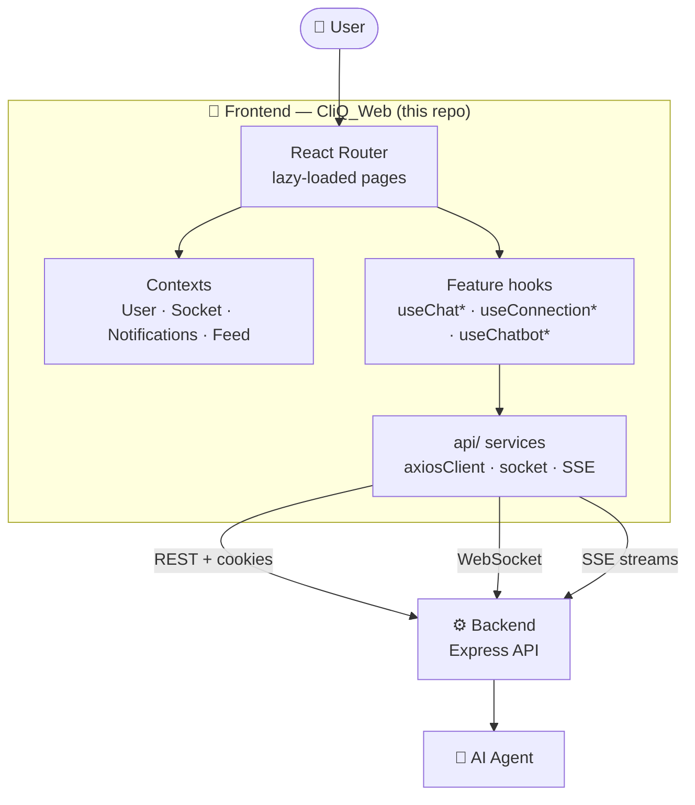

<div align="center">

# 🎨 CliQ — Frontend

### Connect · Share · Collaborate

_A fast, animated, fully responsive React app for an AI-powered social + professional network_

<br/>


<br/>

**`Post`** ➜ **`Discover`** ➜ **`Connect`** ➜ **`Chat`** ➜ **`Collaborate`**

<br/>

[🌐 Live Demo](https://cliq-web-rho.vercel.app/) &nbsp;•&nbsp;
[⚙️ Backend](https://github.com/Aman-kumar-git12/CliQ_Backend) &nbsp;•&nbsp;
[🤖 AI Agent](https://github.com/Aman-kumar-git12/CliQ_Agent)

</div>

---

**CliQ** is a social + professional networking platform: build a profile around your **expertise**, share
posts, discover the **right people** through AI-ranked recommendations, and collaborate over **real-time chat**,
with AI helping at every step.

> [!NOTE]
> This repository is the **web app** users interact with. It is built with React + Vite, styled with
> Tailwind, animated with Framer Motion, and kept live with Socket.IO. It talks **only** to the backend API;
> all AI features reach the AI agent through the backend.

## 📦 Repositories

CliQ is split into three services:

| Service                     | Tech                                      | Repository                                                                        |
| --------------------------- | ----------------------------------------- | --------------------------------------------------------------------------------- |
| 🎨 **Frontend** (this repo) | React · Vite · Tailwind                   | [Aman-kumar-git12/CliQ_Web](https://github.com/Aman-kumar-git12/CliQ_Web)         |
| ⚙️ **Backend**              | Node · Express · Prisma · MongoDB · Redis | [Aman-kumar-git12/CliQ_Backend](https://github.com/Aman-kumar-git12/CliQ_Backend) |
| 🤖 **AI Agent**             | Python · FastAPI · Groq · Embeddings      | [Aman-kumar-git12/CliQ_Agent](https://github.com/Aman-kumar-git12/CliQ_Agent)     |

---

## 🧩 The Problem

Communication is easy today, but meaningful collaboration is still hard:

1. Social apps focus on entertainment, not expertise.
2. Professional platforms feel static and inactive.
3. There is no smooth path from **discovering** someone → **understanding** them → **reaching out**.
4. Messaging, networking and profile building are spread across different tools.
5. Nothing helps users present themselves well or know what to say.

## 💡 The Solution

CliQ puts the whole journey in **one app**, with an interface that feels fast and alive: a live feed,
swipeable match cards, real-time chat, and AI built into the screens where it helps most.

---

## 🏗️ Architecture



Pages stay thin: **feature hooks** hold the logic, and **API services** are the only code that calls the
network.

---

## 🖥️ The Frontend in Depth

### 🎯 Get Connections: swipeable match cards

- Swipe right or left (or use the buttons) to decide on a person. The card **tilts with the pointer** and
  springs back with Framer Motion physics.
- Each card shows **why** this person was suggested (shared skills, similar interests).
- Panels for **history, saved people and insights**. Every action (shown, saved, ignored, interested) is tracked
  to improve future recommendations.
- Recent batches are cached in the browser, so reopening the page is instant.

### 💬 Real-time chat

- Messages, edits, deletes and **online status** arrive live over **one shared Socket.IO connection**.
- Send **files, images, emoji and voice messages** (recorded in the browser with a running timer).
- Duplicate events around a reconnect are ignored, so a message never shows twice.
- **✨ AI assistant overlay:** get reply suggestions in a chosen tone, or ask AI about the conversation, with
  answers streamed live.

### 🤖 CliQ AI chatbot

- A floating help chat, **loaded only when opened**, with multiple saved sessions in a sidebar.
- Answers **stream token by token** via Server-Sent Events, parsed by a small reader that also works in Safari.
- Shows a thinking indicator and **suggestion chips**, renders **Markdown** answers, and has 👍/👎 feedback buttons.

### 📝 Posts and feed

- Home feed with tabs, trending hashtags and "Discover People".
- Posts with images, **link previews**, **@mentions**, reposts, likes, comments, saves and reports.
- **Hover cards** show a person's profile without leaving the page.

### 🧠 Expertise Studio

- Build a structured expertise profile (skills, projects, achievements, interests), shown in **four layouts**.
- **✨ Magic Builder:** answer a few questions and AI drafts the section for you.

### 🔐 Auth and sessions

- Signup, login, **Google Sign-In**, email and OTP verification, password reset and blocked-account flows.
- `ProtectedRoute` and `PublicRoute` guard pages.
- **Silent token refresh:** when the 15-minute session cookie expires, one shared `/auth/refresh` call renews it
  and retries every waiting request. The socket and streaming calls do the same.

---

## ⚡ Performance and UX

| What                  | How                                                                                              |
| --------------------- | ------------------------------------------------------------------------------------------------ |
| **Fast first load**   | Every page is **lazy-loaded**; React, icons and animation get separate long-cached vendor chunks |
| **No layout jumps**   | A dedicated **shimmer skeleton** for every screen (20+)                                          |
| **Fewer requests**    | A short-lived request cache shares results between screens and **dedupes in-flight requests**    |
| **Resilient network** | Failed reads are retried; errors show as toasts; an `ErrorBoundary` catches page crashes         |
| **Smooth motion**     | Shared Framer Motion presets; everything respects the OS **"reduce motion"** setting             |
| **Accessible**        | WCAG AA text contrast, a visible keyboard focus ring everywhere, Escape closes dialogs           |
| **Mobile-first**      | Bottom nav, top bar, safe-area padding for phones with a home indicator                          |
| **Measured**          | Lighthouse CI checks performance, accessibility, best practices and SEO (target ≥ 80)            |

## 🛠️ Problems Solved with Tech

| Problem                               | How the frontend solves it                       | Tech                                  |
| ------------------------------------- | ------------------------------------------------ | ------------------------------------- |
| Discovery feels like scrolling a list | Swipeable, explainable match cards               | Framer Motion gestures                |
| Chat must feel instant                | Live messages, edits and presence                | Socket.IO (one shared connection)     |
| Waiting for AI feels slow             | Answers stream word by word                      | Server-Sent Events + `ReadableStream` |
| Sessions expire mid-use               | Silent refresh and retry, shared by all requests | Axios interceptors                    |
| Big bundles load slowly               | Lazy pages + vendor chunk splitting              | React `lazy`, Vite / Rollup           |
| Screens flash while loading           | Per-screen skeletons                             | Tailwind shimmer components           |
| Duplicate API calls                   | Short-lived cache with in-flight dedupe          | Custom `requestCache`                 |
| Works on every device                 | Responsive layouts, mobile nav, safe areas       | Tailwind CSS                          |

## ✨ Features

- 🔐 **Secure authentication**: signup/login, email verification, OTP, password reset, Google Sign-In
- 👤 **Profiles**: edit details, upload photos, public profiles, hover cards
- 🧠 **Expertise Studio** with the **AI Magic Builder**
- 🤝 **Connections**: send, accept and reject requests, manage your network
- 🎯 **Get Connections**: swipeable AI-ranked match cards with history, saved people and insights
- 📝 **Posts**: images, link previews, mentions, reposts, likes, comments, saves, reports
- 💬 **Real-time chat**: files, images, voice messages, emoji, edit and delete, online status
- ✨ **AI message assistant** and 🤖 **CliQ AI chatbot**, both streaming
- 🔔 **Live notifications** and 🔍 **people search**
- 📱 **Fully responsive** on desktop, tablet and mobile

## 🧰 Tech Stack

| Layer                 | Technologies                                                                                                                             |
| --------------------- | ---------------------------------------------------------------------------------------------------------------------------------------- |
| **UI**                | React 18, React Router 6, Tailwind CSS, Framer Motion, Lucide icons, React Markdown, Emoji Picker                                        |
| **Data and realtime** | Axios, Socket.IO client, Server-Sent Events                                                                                              |
| **Quality**           | Vitest + Testing Library, Playwright (e2e), TypeScript type checks (`@ts-check`), ESLint, Prettier, Lighthouse CI                        |
| **Ops**               | Vite, Vercel, Docker + Nginx, Sentry                                                                                                     |
| **Backend / AI**      | See the [Backend](https://github.com/Aman-kumar-git12/CliQ_Backend) and [AI Agent](https://github.com/Aman-kumar-git12/CliQ_Agent) repos |

---

## ⚡ Getting Started

Requires **Node.js 20.19+** and the [backend](https://github.com/Aman-kumar-git12/CliQ_Backend) running.

```bash
npm install
cp .env.example .env     # set VITE_BACKEND_URL (default http://localhost:2004)
npm run dev              # http://localhost:5173
```

| Variable           | Purpose                              |
| ------------------ | ------------------------------------ |
| `VITE_BACKEND_URL` | Backend API, also used for Socket.IO |
| `VITE_SENTRY_DSN`  | Optional: Sentry error monitoring    |

Only `VITE_` variables reach the browser, so never put secrets in `.env`.

**Production build:** `npm run build` (served by Vercel). To run it in a container:
`docker build --build-arg VITE_BACKEND_URL=... .` (Nginx).

## 🧪 Tests

```bash
npm run check        # ESLint + Prettier + type check + Vitest
npm run test:watch   # re-run unit tests as you edit
npm run test:e2e     # Playwright browser tests: auth, chat, posts, pages
npm run lhci         # Lighthouse CI report
```

## 📁 Project Layout

```
src/
├── main.jsx             entry point
├── App.jsx              routes (lazy-loaded) and providers
├── api/                 axiosClient, socket, one service module per feature (posts, users, chat, aiChat…)
├── context/             UserContext, SocketContext (one shared connection), NotificationContext, FeedContext
├── hooks/               logic pulled out of pages: useChat*, useChatbot*, useConnection*, usePostDetail*…
├── layouts/             MainLayout (sidebar + feed pages), ChatLayout
├── routes/              ProtectedRoute, PublicRoute
├── pages/               one component per route; auth/ holds login, signup, verification
├── components/          building blocks grouped by feature
│   ├── chat/            inbox, AI assistant overlay
│   ├── chatbot/         CliQ AI help chat
│   ├── connections/     match cards, history, dashboard, saved
│   ├── expertise/       expertise view and its four layouts
│   ├── posts/           post card, comments, mentions, reposts, link previews
│   ├── profile/         header, stats, tabs, hover card
│   ├── common/          ConfirmDialog, ErrorBoundary, toaster, PageLoader, motion presets
│   └── shimmering/      loading skeletons
├── utils/               small pure helpers (requestCache, readSseEvents, timeAgo…)
└── test/                test setup and cross-module tests
e2e/                     Playwright specs
```

---

## 🔗 Related Repositories

- 🌐 Live website: https://cliq-web-rho.vercel.app/
- ⚙️ Backend: https://github.com/Aman-kumar-git12/CliQ_Backend
- 🤖 AI Agent: https://github.com/Aman-kumar-git12/CliQ_Agent
